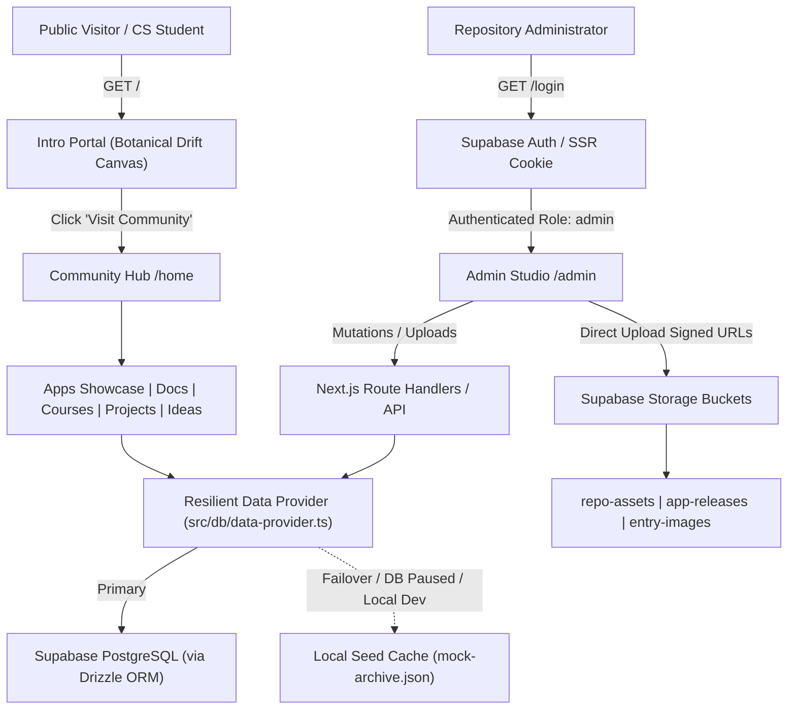
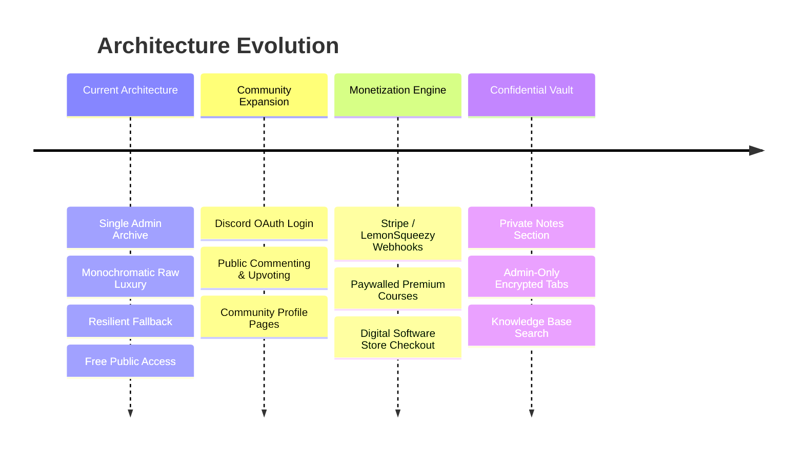

# JeptahzRepo: Technical Architecture & System Design

This document details the engineering specifications, data flow patterns, security models, and future expansion paths for **JeptahzRepo**.

---

## 1. System Context & High-Level Architecture

JeptahzRepo operates as a dual-surface application:
1. **Public Archival Surface (`/`, `/home/**`):** High-speed, edge-cached, read-only interface optimized for students, developers, and researchers.
2. **Admin Control Studio (`/admin/**`, `/login`):** Authenticated, encrypted environment allowing the sole administrator to author, edit, delete, and curate repository assets.



---

## 2. Resilience & Zero-Downtime Architecture

### The Problem
Traditional full-stack apps fail completely (throwing HTTP 500 or blank white screens) when a cloud database experiences downtime, network timeouts, or when free-tier instances (like Supabase) auto-pause after inactivity.

### The Solution: 3-Tier Resilience Strategy
1. **Edge Caching via Next.js ISR (Incremental Static Regeneration):**
   * Public repository pages are pre-rendered at build time and cached on Vercel's global CDN.
   * Cached pages serve visitors in sub-30ms, even if the origin database is temporarily unreachable.
2. **Graceful Fallback Data Provider (`src/db/data-provider.ts`):**
   * All database queries run through a resilient wrapper function.
   * If the connection fails or `DATABASE_URL` is omitted, the application catches the exception and immediately hydrates the UI with pre-compiled, structured seed data (`src/db/seeds/mock-archive.json`).
3. **Database Portability:**
   * Schema is written in standard ANSI SQL (`001_initial_schema.sql`) and defined via **Drizzle ORM**.
   * Switching database providers (e.g. from Supabase to Neon, Railway, AWS RDS, or local Docker) requires modifying a single environment string (`DATABASE_URL`).

---

## 3. Security Architecture & Single-Admin Isolation

### Authentication Flow
* Authentication is handled via Supabase Auth using HTTP-only, secure, same-site session cookies managed by `@supabase/ssr`.
* Next.js Edge Middleware inspects the session token on any request starting with `/admin`:
  * If no session exists ➔ Redirects immediately to `/login`.
  * If a session exists ➔ Queries the `profiles` table to verify `role === 'admin'`. If role is `'guest'`, access is denied (HTTP 403).

### Row Level Security (RLS) Dual Protection
Even if an API endpoint were misconfigured, the PostgreSQL database itself enforces strict access barriers:
* **`SELECT`:** Permitted for `anon` and `authenticated` roles, restricted to records where `is_published = true AND is_private = false`.
* **`INSERT` / `UPDATE` / `DELETE`:** Strictly constrained by PostgreSQL RLS:
  ```sql
  create policy "Admin only mutation" on public.entries
  for all using (auth.uid() in (select id from public.profiles where role = 'admin'));
  ```

---

## 4. Storage Architecture (Supabase Storage)

The repository utilizes three isolated storage buckets:
1. `entry-images`: Public bucket for article header banners, inline screenshots, and thumbnails (optimized via Next.js Image).
2. `app-releases`: Storage for compiled software executables, zip bundles, and release packages.
3. `repo-assets`: Academic PDFs, lecture slides, and starter code templates.

Direct client-to-storage signed uploads eliminate serverless memory bottlenecks by streaming uploads directly to Supabase via signed URLs generated by `/api/upload`.

---

## 5. Future-Proofing Roadmap

The codebase and database schema are built with dedicated fields to enable future monetization and community features without schema rewrites:



* **Discord Community Login:** `profiles.discord_id` and `profiles.auth_provider` exist in schema. Enabling takes 1 toggle in Supabase Auth.
* **Paywalled Courses & Content:** `entries.access_level` (`'public' | 'community' | 'premium'`) and `entries.price_usd` allow instant Stripe payment-gate integration.
* **Paid Applications & Digital Store:** `apps.is_paid` and `apps.price_usd` allow switching the GDrive download button to a checkout button.
* **Private / Hidden Vault:** `entries.is_private` column ensures confidential notes are visible only to the authenticated administrator.
