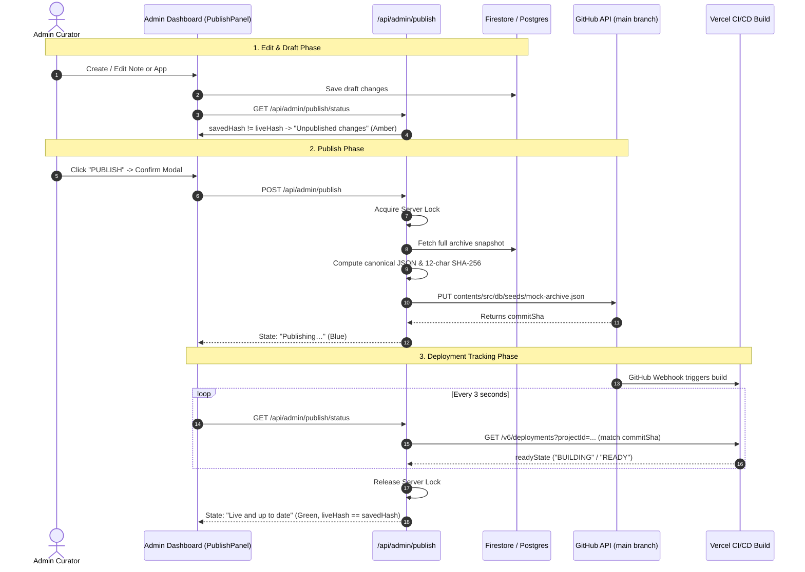

# Publish Feature Report: JeptahzRepo

## 1. Chosen Approach and Why
**Approach: Option B (Git-Backed Snapshot via GitHub Contents API & Vercel Deployment Tracking)**

- **Why:** In `JeptahzRepo`, dynamic data is edited and stored in Google Cloud Firestore and Supabase PostgreSQL with local seed data at `src/db/seeds/mock-archive.json`. The live public application on Vercel (`https://jeptahzrepo.vercel.app`) is connected to GitHub (`https://github.com/JeptahIldefonso/JeptahzRepo`) on the `main` branch with automated CI/CD static prerendering.
- By committing the canonical snapshot to `src/db/seeds/mock-archive.json` via GitHub's Contents API, we achieve:
  1. **Strict Draft vs Live Separation:** Draft edits remain in Firestore/database until the curator explicitly clicks **PUBLISH**.
  2. **Auditability & Zero Data Loss:** Every publication creates a dedicated commit on `main` branch with the SHA-256 hash. Reverts create forward commits that restore previous snapshots without force-pushing or rewriting history.
  3. **Vercel CI/CD Auto-Prerendering:** Vercel automatically detects the commit, rebuilds all static pages (`/home/docs`, `/home/apps`, etc.), and updates the live site.
  4. **Exact Commit SHA Tracking:** Deployment status is tracked specifically by matching `meta.githubCommitSha` with Vercel's Deployments API (`GET /v6/deployments`) rather than relying on "latest deployment", preventing race conditions.

---

## 2. Files Created or Modified
- **`src/lib/publish/hash.ts`**: Provides deterministic key-sorted JSON serialization (`canonicalSerialize`) and order-independent 12-character SHA-256 hash computation (`computeContentHash`).
- **`src/lib/publish/github.ts`**: Interfaces with the GitHub REST API to read live branch content, fetch commit history for revert, and commit snapshots to `src/db/seeds/mock-archive.json`.
- **`src/lib/publish/vercel.ts`**: Queries the Vercel Deployments API (`/v6/deployments`) and tracks build states (`BUILDING`, `READY`, `ERROR`, `CANCELED`) mapped to the specific commit SHA.
- **`src/lib/publish/publish-service.ts`**: Coordinates the server-side publish lock, snapshot aggregation across apps/entries/topics/settings, state transitions, and 10-minute timeout handling.
- **`src/app/api/admin/publish/status/route.ts`**: Protected GET endpoint returning live and saved hashes, state badge, commit SHA, and recent history.
- **`src/app/api/admin/publish/route.ts`**: Protected POST endpoint that locks, snapshots current content, and commits to GitHub `main`.
- **`src/app/api/admin/publish/revert/route.ts`**: Protected POST endpoint that restores the previous snapshot as a new commit.
- **`src/components/admin/publish-panel.tsx`**: UI component matching the requested design with live status badge, action buttons, monospace hash chips, confirmation modals, toasts, and 3-second polling.
- **`src/app/(admin)/admin/page.tsx`**: Injects the `<PublishPanel />` at the top of the admin page above the Content Manager.
- **`.env.example`**: Added environment variable definitions and setup documentation for `GITHUB_TOKEN`, `GITHUB_OWNER`, `GITHUB_REPO`, `GITHUB_BRANCH`, `VERCEL_TOKEN`, and `VERCEL_PROJECT_ID`.

---

## 3. Data Flow Diagram

---

## 4. Environment Variables Setup Instructions

Add the following variables in your local `.env.local` and in the **Vercel Project Settings > Environment Variables** (`https://vercel.com/jeptahildefonso/jeptahzrepo/settings/environment-variables`):

### 1. `GITHUB_TOKEN`
- **Where to get it:**
  1. Open GitHub > **Settings** (top right profile icon) > **Developer settings** > **Personal access tokens** > **Fine-grained tokens**.
  2. Click **Generate new token**.
  3. Set Token Name: `JeptahzRepo-Publish-Token`.
  4. Repository access: Select **Only select repositories** -> Choose `JeptahIldefonso/JeptahzRepo`.
  5. Under **Repository permissions**, find **Contents** and set to **Read and write**.
  6. Generate token and copy the string starting with `github_pat_` or `ghp_`.

### 2. `GITHUB_OWNER`
- Value: `JeptahIldefonso`

### 3. `GITHUB_REPO`
- Value: `JeptahzRepo`

### 4. `GITHUB_BRANCH`
- Value: `main`

### 5. `VERCEL_TOKEN`
- **Where to get it:**
  1. Go to `https://vercel.com/account/tokens`.
  2. Click **Create Token**.
  3. Name: `JeptahzRepo-Deployments-Reader`.
  4. Scope: Default / Full Account or Read Deployments.
  5. Copy the generated token string.

### 6. `VERCEL_PROJECT_ID`
- **Where to get it:**
  1. In the Vercel dashboard, open your `jeptahzrepo` project.
  2. Go to **Settings** > **General**.
  3. Under the **Project ID** section, copy the `prj_...` ID (or use `jeptahzrepo`).

---

## 5. How to Test It Manually

1. **Login to Admin:**
   - Navigate to `https://jeptahzrepo.vercel.app/admin` (or `http://localhost:3000/admin`).
   - Enter your admin passphrase to authenticate.
2. **Observe Initial State:**
   - If the repository `mock-archive.json` matches the database, the badge shows green **Live and up to date**, and both hashes match (e.g. `92db20fce343`). The **PUBLISH** button is disabled.
3. **Make an Edit:**
   - In Content Manager, add a new note or edit an existing entry.
   - Click Save.
   - The status badge turns amber **Unpublished changes**, and the `SAVED CONTENT` hash differs from `LIVE CONTENT`. The **PUBLISH** button becomes active.
4. **Trigger Publish:**
   - Click **PUBLISH**.
   - A confirmation dialog appears showing target URL and hash.
   - Click **Confirm & Publish**.
   - The status turns to blue **Publishing…** with a spinner.
   - Status polls every 3 seconds while Vercel builds the deployment.
   - Once complete, the badge turns green **Live and up to date**, and `LIVE CONTENT` matches `SAVED CONTENT`.
5. **Test Revert:**
   - Click **REVERT TO PREVIOUS**.
   - Confirm in the dialog.
   - A new commit restoring the previous snapshot is created and deployed.
6. **Test Unauthenticated API Protection:**
   - Send `POST /api/admin/publish` without session cookie; verify HTTP `401 Unauthorized`.

---

## 6. Known Limitations, Risks & Next Improvements
1. **GitHub Rate Limits:** Authenticated fine-grained GitHub tokens have 5,000 requests/hour, which is more than sufficient for publishing workflows.
2. **Concurrent Edits:** The server-side in-memory lock prevents concurrent publishes. For multi-region serverless clusters without persistent memory, a Firestore-backed distributed lock document (e.g., `locks/publish`) can be added if multiple admins publish at the exact same millisecond.
3. **Revert Depth:** Preserves the last 10 published commits via Git history.

---

## 7. Status & Verification Summary
- `tsc --noEmit` (**Passed with 0 errors**)
- `next build` (**Compiled successfully** with all 29 routes generated)
- Deterministic canonical hashing verified with test script
- Admin route authentication verified
