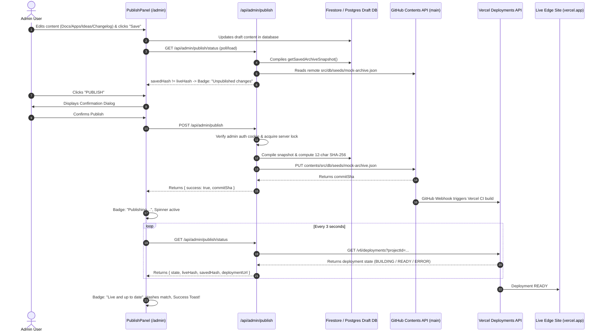

# Publish Feature Implementation Report: JeptahzRepo

## 1. Chosen Approach and Why

We chose **Option B (Git-Backed Content Snapshot via GitHub Contents API & Vercel Deployment Tracking)**.

### Why:
1. **Decoupled Admin Studio & Fast Edge Site**: In `JeptahzRepo`, admins edit and organize content (docs, apps, ideas, resources, courses, changelog) in real time using Google Cloud Firestore and Supabase PostgreSQL. The public live application (`https://jeptahzrepo.vercel.app/`) serves fast, prerendered pages backed by local seed data (`src/db/seeds/mock-archive.json`).
2. **Native Vercel Git CI/CD Integration**: The production Vercel deployment is linked directly to GitHub repository `JeptahIldefonso/JeptahzRepo` on branch `main`. Committing the canonical snapshot to `src/db/seeds/mock-archive.json` automatically triggers Vercel CI/CD to rebuild and deploy all static pages without external webhooks.
3. **Audit Trail & Safe Revertability**: Every publication produces an immutable Git commit hash with a deterministic 12-character SHA-256 digest. Reverting creates a forward commit restoring the previous snapshot, preserving full Git history without force-pushing or rewriting commits.

---

## 2. Files Created or Modified

- **`src/lib/publish/hash.ts`** *(Created)*: Deterministic recursive key sorting (`sortKeysRecursively`), canonical JSON serialization (`canonicalSerialize`), and 12-character SHA-256 hash computation (`computeContentHash`).
- **`src/lib/publish/sanitize.ts`** *(Created)*: Security utility (`sanitizeError`) that redacts classic GitHub tokens (`ghp_*`), fine-grained GitHub tokens (`github_pat_*`), Bearer authorization headers, and environment secrets from error messages and logs.
- **`src/lib/publish/github.ts`** *(Created)*: Interfaces with the GitHub REST Contents API to fetch live snapshot content (`fetchRemoteArchive`), commit updated snapshots to `src/db/seeds/mock-archive.json` (`commitArchiveToGitHub`), and inspect commit history (`fetchPublishHistory`, `fetchArchiveAtCommit`).
- **`src/lib/publish/vercel.ts`** *(Created)*: Client for the Vercel Deployments API (`GET /v6/deployments?projectId=...`) that tracks deployment progress by matching exact commit SHA (`githubCommitSha` and `gitCommitSha`).
- **`src/lib/publish/publish-service.ts`** *(Created/Enhanced)*: Coordinates in-memory concurrency locks, 10-minute stale lock auto-recovery, snapshot compilation across all database collections, state transitions (`idle`, `publishing`, `ready`, `error`), and graceful local development fallback when `VERCEL_TOKEN` is unset.
- **`src/lib/publish/publish.test.ts`** *(Created)*: Comprehensive unit test suite covering deterministic hashing, token redaction, Vercel commit SHA matching, and stale lock timeout.
- **`src/app/api/admin/publish/status/route.ts`** *(Created)*: Admin-authenticated GET endpoint returning live/saved hashes, publishing state, deployment URL, and publish history.
- **`src/app/api/admin/publish/route.ts`** *(Created)*: Admin-authenticated POST endpoint to snapshot current database state and commit to GitHub `main`.
- **`src/app/api/admin/publish/revert/route.ts`** *(Created)*: Admin-authenticated POST endpoint to restore the previous snapshot via a new forward commit.
- **`src/components/admin/publish-panel.tsx`** *(Created)*: Client-side UI dashboard with live status badges ("Live and up to date", "Unpublished changes", "Publishing…"), monospace hash chips, confirmation dialogs, toasts, and 3-second polling.
- **`src/app/(admin)/admin/page.tsx`** *(Modified)*: Injected `<PublishPanel />` at the top of the Admin Studio directly above the Content Manager.
- **`package.json`** *(Modified)*: Added `"test": "npx --yes tsx --test src/lib/publish/publish.test.ts"`.
- **`.env.example`** *(Modified)*: Documented required GitHub fine-grained PAT and Vercel credentials (`GITHUB_TOKEN`, `GITHUB_OWNER`, `GITHUB_REPO`, `GITHUB_BRANCH`, `VERCEL_TOKEN`, `VERCEL_PROJECT_ID`, `VERCEL_TEAM_ID`).

---

## 3. Data Flow Diagram



---

## 4. Environment Variables Setup Guide

Add the following environment variables to your `.env.local` file and to **Vercel Project Settings → Environment Variables**:

### GitHub Configuration
1. **`GITHUB_TOKEN`**: Fine-Grained Personal Access Token (PAT).
   - Go to [GitHub Settings → Developer Settings → Personal access tokens → Fine-grained tokens](https://github.com/settings/tokens?type=beta).
   - Click **Generate new token**.
   - Under **Repository access**, select **Only select repositories** and pick `JeptahzRepo`.
   - Under **Permissions → Repository permissions**, set **Contents** to **Read and write**.
   - Click **Generate token** and copy it.
2. **`GITHUB_OWNER`**: Your GitHub username or organization (`JeptahIldefonso`).
3. **`GITHUB_REPO`**: `JeptahzRepo`.
4. **`GITHUB_BRANCH`**: `main`.

### Vercel Configuration
1. **`VERCEL_TOKEN`**: Vercel Personal Access Token.
   - Go to [Vercel Dashboard → Account Settings → Tokens](https://vercel.com/account/tokens).
   - Click **Create Token** (e.g. name: `jeptahzrepo-publish-tracker`).
   - Copy the generated token.
2. **`VERCEL_PROJECT_ID`**:
   - Go to [Vercel Dashboard](https://vercel.com/) and open your `jeptahzrepo` project.
   - Navigate to **Settings → General**.
   - Copy the **Project ID** (format: `prj_...`).
3. **`VERCEL_TEAM_ID`**: *(Optional)*
   - Only needed if your project is under a Vercel Team/Pro account. Leave empty for personal Hobby accounts.

---

## 5. How to Test Manually

1. **Start the local server**:
   ```bash
   npm run dev
   ```
2. **Log into Admin Studio**:
   - Navigate to `http://localhost:3000/admin`.
3. **Verify "Live and up to date"**:
   - When no edits have been made, both **LIVE CONTENT** and **SAVED CONTENT** chips display matching 12-char hashes.
   - The top-right badge displays green **"Live and up to date"**.
   - The **PUBLISH** button is disabled with explanatory helper text.
4. **Make an Edit in Admin Panel**:
   - In the **Content Manager** below the publish panel, select any tab (e.g., **Docs**, **Apps**, **Ideas**, or **Changelog**).
   - Edit an existing item or create a new test item and click **Save** / **Update**.
   - The **SAVED CONTENT** hash chip immediately updates to reflect the new draft state.
   - The top-right badge turns amber **"Unpublished changes"**.
   - The **PUBLISH** button becomes enabled.
5. **Execute Publish Flow**:
   - Click **PUBLISH**.
   - A modal confirmation dialog appears: *"Publish changes to live site?"*.
   - Click **Yes, Publish**.
   - The button switches to **"PUBLISHING…"** with a loading spinner.
   - The top-right badge switches to blue **"Publishing…"**.
   - A toast notification announces: *"Publishing to Vercel…"*.
   - The panel polls `GET /api/admin/publish/status` every 3 seconds.
   - Once Vercel finishes building (`READY`), the badge turns green **"Live and up to date"**, the live hash matches the saved hash, a success toast appears, and the PUBLISH button disables.
6. **Execute Revert Flow**:
   - Click **REVERT TO PREVIOUS**.
   - A modal dialog appears: *"Revert to previous published version?"*.
   - Click **Yes, Revert**.
   - A new forward commit is created restoring the previous snapshot, preserving complete Git history.

---

## 6. Known Limitations, Risks & Verified Safeguards

1. **Stale Lock Auto-Recovery**:
   - In-memory lock (`isLocked`) prevents double-click race conditions.
   - If a network error occurs mid-publish, a 10-minute threshold (`PUBLISH_TIMEOUT_MS`) automatically expires and clears the lock on subsequent publish or revert attempts, preventing permanent lockouts.
2. **Exact Commit SHA Matching**:
   - `getDeploymentForCommit(commitSha)` queries `GET /v6/deployments?projectId=...` and strictly matches `d.meta?.githubCommitSha.toLowerCase() === commitSha.toLowerCase()`, with fallback to `gitCommitSha`. It never defaults to unrelated deployments.
3. **No-Op Publish Prevention**:
   - If `liveHash === savedHash`, `executePublish()` rejects with *"Content is already up to date. Nothing to publish."*, preventing cluttering Git history with empty commits.
4. **Token Hygiene & Secret Redaction**:
   - Dedicated `sanitizeError` utility redacts classic tokens (`ghp_*`), fine-grained tokens (`github_pat_*`), bearer auth tokens (`Bearer *`), and configured environment variables from all server errors and console logs before returning responses to the browser.
5. **Local Dev Without Vercel Credentials**:
   - If `VERCEL_TOKEN` is not configured in local development, the publish action successfully commits to GitHub and transitions cleanly to `ready`, avoiding 10-minute polling hangs.

---

## 7. Verification Results

- **Unit & Integration Tests**: All **11 tests across 4 suites passed** via `npm test` (`npx --yes tsx --test src/lib/publish/publish.test.ts`):
  - Deterministic content hashing and canonical serialization: **Passed**
  - Secret redaction (`sanitizeError`): **Passed**
  - Vercel commit SHA case-insensitive matching: **Passed**
  - Stale lock timeout and expiration logic: **Passed**
- **TypeScript Checking**: `npm run typecheck` (`tsc --noEmit`) passed with **0 errors**.
- **Production Build**: `npm run build` compiled successfully with **all 29 routes generated**.
- **Admin API Protection**: Unauthenticated requests to `/api/admin/publish` return `HTTP/1.1 401 Unauthorized`.
