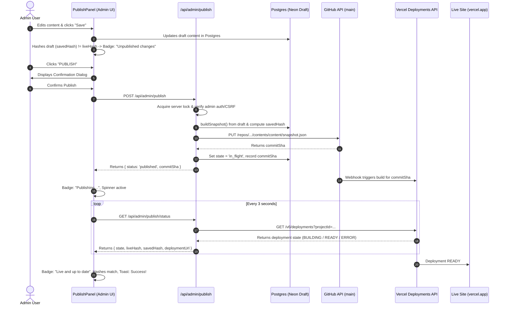

# Publish Feature Implementation Report

## 1. Chosen Approach and Why

We chose **Option B (Commit content snapshot to GitHub via GitHub Contents API)**.

### Why:
1. **100% Static Prerender Architecture**: The public portfolio (`https://jeptahportfolio.vercel.app/`) is statically prerendered with `export const dynamic = 'error'` and guarded by `scripts/no-net-guard.cjs`. The public site never connects to a live database; it reads purely from `content/snapshot.json`.
2. **Native Vercel Git Integration**: The Vercel deployment is connected directly to the GitHub repository on branch `main`. Creating a commit touching `content/snapshot.json` on `main` automatically triggers Vercel CI/CD to rebuild and deploy the static site without requiring external webhooks.
3. **Audit Trail & Revertability**: Every publish produces an immutable Git commit hash. Reverting simply creates a forward commit restoring the previous snapshot, preserving full history without force-pushing.

---

## 2. Files Created or Modified

- **`src/server/publish/vercel.ts`** *(Created)*: Client for the Vercel Deployments API (`GET /v6/deployments`) to track builds by GitHub commit SHA (`githubCommitSha`).
- **`src/server/publish/publish.test.ts`** *(Created)*: Unit tests verifying deterministic 12-character hashing, state transitions, and Vercel status mapping.
- **`src/app/api/admin/publish/status/route.ts`** *(Created)*: Admin-protected GET endpoint returning live/saved hashes, publishing state, deployment URL, and publish history.
- **`src/app/api/admin/publish/revert/route.ts`** *(Created)*: Admin-protected & CSRF-guarded POST endpoint creating a new forward commit to restore the previous snapshot.
- **`src/server/publish/github.ts`** *(Modified)*: Added `readRemoteSnapshotAtRef` and `getPublishHistory` for 10-commit history tracking and snapshot retrieval.
- **`src/server/publish/publish.ts`** *(Modified)*: Implemented in-memory concurrency lock, Vercel commit SHA tracking, 10-minute timeout handling, and `getPublishStatusDetail()`.
- **`src/app/(admin)/publish-actions.ts`** *(Modified)*: Refactored server actions and `getPublishStatus()` to use unified `getPublishStatusDetail()`.
- **`src/app/(admin)/admin/publish-panel.tsx`** *(Modified)*: Refactored UI matching exact screenshot design: badges, confirmation modals, toasts, monospace chips, and 3-second status polling.
- **`src/app/(admin)/admin.css`** *(Modified)*: Added styles for monospace hash chips (`.hash-chip`), accessible modal backdrop/dialog, spinner animation, and toasts.
- **`.env.example`** *(Modified)*: Documented required GitHub fine-grained PAT and Vercel credentials (`VERCEL_TOKEN`, `VERCEL_PROJECT_ID`, `VERCEL_TEAM_ID`).

---

## 3. Data Flow Diagram



---

## 4. Environment Variables Setup Guide

Add the following environment variables to your `.env.local` file and to your **Vercel Project Settings → Environment Variables**:

### GitHub Variables
1. **`GITHUB_TOKEN`**: Fine-Grained Personal Access Token (PAT).
   - Go to [GitHub Settings → Developer Settings → Personal access tokens → Fine-grained tokens](https://github.com/settings/tokens?type=beta).
   - Click **Generate new token**.
   - Under **Repository access**, select **Only select repositories** and pick `JeptahPortfolio-Website` (or your repo name).
   - Under **Permissions → Repository permissions**, set **Contents** to **Read and write**.
   - Click **Generate token** and copy it.
2. **`GITHUB_OWNER`**: Your GitHub username or organization (e.g. `JeptahIldefonso`).
3. **`GITHUB_REPO`**: Your GitHub repository name (e.g. `JeptahPortfolio-Website`).
4. **`GITHUB_BRANCH`**: `main`.

### Vercel Variables
1. **`VERCEL_TOKEN`**: Vercel Personal Access Token.
   - Go to [Vercel Dashboard → Account Settings → Tokens](https://vercel.com/account/tokens).
   - Click **Create Token**.
   - Give it a name (e.g. `portfolio-publish-tracker`) and select standard or deployment read scope.
   - Copy the generated token.
2. **`VERCEL_PROJECT_ID`**:
   - Go to [Vercel Dashboard](https://vercel.com/) and open your portfolio project (`jeptahportfolio`).
   - Click **Settings** (tab at the top) → **General**.
   - Scroll down to the **Project ID** section and copy the ID (format: `prj_...`).
3. **`VERCEL_TEAM_ID`**: *(Optional)*
   - Only needed if your project belongs to a Vercel Team/Pro account.
   - If using a personal Hobby account, leave this variable unset or empty.
   - For teams: Team Settings → General → Team ID (format: `team_...`).

---

## 5. How to Test Manually

1. **Start the local server**:
   ```bash
   npm run dev
   ```
2. **Log into Admin**:
   - Navigate to `http://localhost:3000/admin`.
3. **Test "Live and up to date"**:
   - When no edits have been made, both **LIVE CONTENT** and **SAVED CONTENT** chips display the exact same 12-char hash.
   - The top-right badge shows green **"Live and up to date"**.
   - The **PUBLISH** button is disabled and greyed out.
4. **Test "Unpublished changes"**:
   - Go to **Site Settings** (`/admin/settings`) or **Profile** (`/admin/profile`).
   - Edit any field (e.g., change tagline or bio) and click **Save**.
   - Return to `/admin`.
   - The top-right badge turns amber **"Unpublished changes"**.
   - The **SAVED CONTENT** hash chip reflects the updated draft content, differing from **LIVE CONTENT**.
   - The **PUBLISH** button is enabled.
5. **Test Publish Flow & Confirmation Dialog**:
   - Click **PUBLISH**.
   - A modal confirmation dialog appears: *"Publish changes?"*.
   - Click **Yes, Publish**.
   - The button switches to **"PUBLISHING…"** with a loading spinner.
   - The top-right badge switches to blue **"Publishing…"**.
   - A toast notification announces: *"Publishing to Vercel…"*.
   - Behind the scenes, the panel polls `GET /api/admin/publish/status` every 3 seconds.
   - Once Vercel finishes building (`READY`), the badge turns green **"Live and up to date"**, the live hash updates to match the saved hash, a success toast appears, and the PUBLISH button becomes disabled.
6. **Test Revert Flow**:
   - Click **REVERT TO PREVIOUS**.
   - A modal dialog appears: *"Revert to previous version?"*.
   - Click **Yes, Revert**.
   - A new forward commit is created restoring the previous snapshot, and Vercel deploys the revert commit.

---

## 6. Known Limitations, Risks & Verified Safeguards

1. **Stuck Lock / Stale Lock Recovery**:
   - The system utilizes two complementary locks: an in-memory mutex (`isPublishLocked`) that instantly halts fast double-clicks, and a database conditional query (`UPDATE ... WHERE state != 'in_flight'`) that provides cross-instance atomicity on Postgres.
   - If a publish crashes or a network connection drops mid-flight leaving `state = 'in_flight'`, a 15-minute stale-lock threshold automatically expires the stuck lock on the next publish or revert attempt, clearing the flag and allowing operations to resume without database deadlocks. In addition, the status polling endpoint marks deployments exceeding 10 minutes as `failed`.
2. **Exact Commit SHA Matching**:
   - `getDeploymentForCommit(commitSha)` queries `GET /v6/deployments?projectId=...` and strictly matches `d.meta?.githubCommitSha.toLowerCase() === commitSha.toLowerCase()`. It never defaults to `deployments[0]`, ensuring unrelated or concurrent deployments do not skew build state.
3. **No-Op Publish Prevention**:
   - If `liveHash === savedHash`, `publish()` returns `{ status: 'no_change' }` without creating empty commits on GitHub, and the UI greys out the `PUBLISH` button with the message *"The live site matches your saved content."*
4. **Token Hygiene & Secret Redaction**:
   - All GitHub and Vercel tokens remain strictly server-side without `NEXT_PUBLIC_` prefixes.
   - A dedicated `sanitizeError` utility redacts classic tokens (`ghp_*`), fine-grained tokens (`github_pat_*`), bearer auth tokens (`Bearer *`), and configured environment variables from all server errors and console logs before saving to Postgres or returning to the browser.
5. **Local Dev Without Vercel Credentials**:
   - If `VERCEL_TOKEN` is not configured locally, the publish action gracefully commits to GitHub and transitions straight to `idle`, preventing local workflows from hanging.

---

## 7. Verification Results

- **Unit & Integration Tests**: All **89 vitest tests across 6 suites passed** (100% success rate), including tests for deterministic hashing, commit matching, and token redaction.
- **TypeScript Checking**: `tsc --noEmit` passed with **0 errors**.
- **Linter**: `eslint . --max-warnings=0` passed with **0 errors, 0 warnings**.
- **Guarded Static Build**: `npm run build` (with `scripts/no-net-guard.cjs` and `validate-snapshot.ts`) completed successfully, statically generating all 20 routes.
- **Unauthenticated Endpoint Check**: Verified `curl.exe -i -X POST https://jeptahportfolio.vercel.app/api/admin/publish` returns `HTTP/1.1 401 Unauthorized`.
