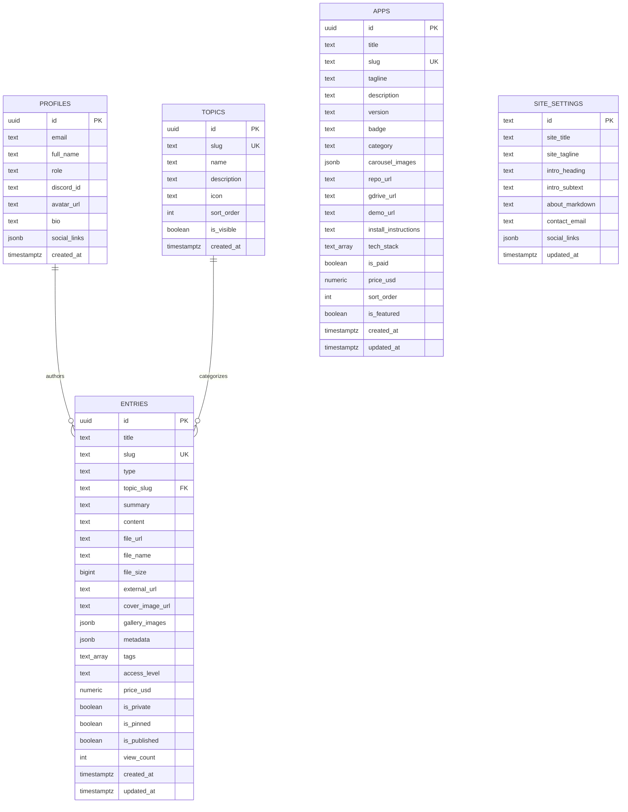

# JeptahzRepo: Database Schema Specification

This document provides the complete PostgreSQL schema, Drizzle ORM mappings, table definitions, relational constraints, and Row Level Security (RLS) policies.

---

## 1. Entity-Relationship Overview

---

## 2. Table Specifications

### 2.1 `profiles`
Stores administrator credentials, public bio, and future community members.

| Column | Type | Constraints | Description |
| :--- | :--- | :--- | :--- |
| `id` | `uuid` | `PRIMARY KEY`, references `auth.users(id)` | User ID synced with Supabase Auth |
| `email` | `text` | `NOT NULL` | User email address |
| `full_name`| `text` | `NULLABLE` | Display name |
| `role` | `text` | `NOT NULL DEFAULT 'guest'` | Role check: `'admin'`, `'guest'` |
| `discord_id`| `text` | `NULLABLE` | Future Discord OAuth identifier |
| `avatar_url`| `text` | `NULLABLE` | Avatar image path |
| `bio` | `text` | `NULLABLE` | Short biographical statement |
| `social_links`| `jsonb`| `DEFAULT '{}'::jsonb` | GitHub, LinkedIn, Twitter, Website URLs |
| `created_at`| `timestamptz` | `DEFAULT now()` | Record creation timestamp |

---

### 2.2 `topics`
Taxonomy categories driving the sidebar navigation and filter pills.

| Column | Type | Constraints | Description |
| :--- | :--- | :--- | :--- |
| `id` | `uuid` | `PRIMARY KEY DEFAULT gen_random_uuid()` | Unique identifier |
| `slug` | `text` | `UNIQUE NOT NULL` | URL slug (e.g. `docs`, `courses`, `projects`) |
| `name` | `text` | `NOT NULL` | Human-readable title |
| `description`| `text` | `NULLABLE` | Category description |
| `icon` | `text` | `NULLABLE` | Lucide icon identifier |
| `sort_order`| `int` | `DEFAULT 0` | Sidebar ordering index |
| `is_visible`| `boolean`| `DEFAULT true` | Toggle visibility |
| `created_at`| `timestamptz` | `DEFAULT now()` | Timestamp |

---

### 2.3 `entries`
The unified polymorphic table accommodating documents, course syllabi, downloadable files, links, and ideas.

| Column | Type | Constraints | Description |
| :--- | :--- | :--- | :--- |
| `id` | `uuid` | `PRIMARY KEY DEFAULT gen_random_uuid()` | Unique entry identifier |
| `title` | `text` | `NOT NULL` | Article or resource headline |
| `slug` | `text` | `UNIQUE NOT NULL` | SEO-friendly URL slug |
| `type` | `text` | `NOT NULL` | Type: `text`, `file`, `link`, `course`, `image`, `idea`, `doc` |
| `topic_slug`| `text` | `REFERENCES topics(slug)` | Category association |
| `summary` | `text` | `NULLABLE` | Brief excerpt or card summary |
| `content` | `text` | `NULLABLE` | Rich Markdown text / code snippets |
| `file_url` | `text` | `NULLABLE` | Supabase Storage URL or external file |
| `file_name`| `text` | `NULLABLE` | Original file name |
| `file_size`| `bigint` | `NULLABLE` | Stored in bytes |
| `external_url`| `text`| `NULLABLE` | Target URL for bookmarks or repo links |
| `cover_image_url`| `text`| `NULLABLE` | Header image |
| `gallery_images`| `jsonb`| `DEFAULT '[]'::jsonb` | Array of image URLs for galleries |
| `metadata` | `jsonb` | `DEFAULT '{}'::jsonb` | Custom attributes (duration, difficulty, semester) |
| `tags` | `text[]`| `DEFAULT '{}'::text[]` | Filter tags |
| `access_level`| `text` | `DEFAULT 'public'` | Future monetization: `public`, `community`, `premium`, `admin` |
| `price_usd`| `numeric(10,2)`| `DEFAULT 0.00` | Future paywalled course price |
| `is_private`| `boolean`| `DEFAULT false` | Flag for secret/hidden notes |
| `is_pinned` | `boolean`| `DEFAULT false` | Stickied to top of section |
| `is_published`| `boolean`| `DEFAULT true` | Public visibility flag |
| `view_count`| `int` | `DEFAULT 0` | Analytics counter |
| `created_at`| `timestamptz` | `DEFAULT now()` | Timestamp |
| `updated_at`| `timestamptz` | `DEFAULT now()` | Timestamp |

---

### 2.4 `apps`
Dedicated table for personal application builds, carousels, and downloads.

| Column | Type | Constraints | Description |
| :--- | :--- | :--- | :--- |
| `id` | `uuid` | `PRIMARY KEY DEFAULT gen_random_uuid()` | App ID |
| `title` | `text` | `NOT NULL` | Application name |
| `slug` | `text` | `UNIQUE NOT NULL` | URL identifier |
| `tagline` | `text` | `NOT NULL` | One-line descriptive hook |
| `description`| `text` | `NULLABLE` | Markdown deep-dive / architecture review |
| `version` | `text` | `DEFAULT 'v1.0.0'` | Current release tag |
| `badge` | `text` | `DEFAULT 'Active'` | `Active`, `Beta`, `Archived`, `Experimental` |
| `category` | `text` | `DEFAULT 'Desktop App'` | `Desktop App`, `Web Utility`, `CLI Tool`, `Mobile` |
| `carousel_images`| `jsonb`| `DEFAULT '[]'::jsonb` | Array of `[{ url: string, caption: string }]` |
| `repo_url` | `text` | `NULLABLE` | GitHub / GitLab URL |
| `gdrive_url`| `text` | `NULLABLE` | Google Drive installer download link |
| `demo_url` | `text` | `NULLABLE` | Web demo live preview |
| `install_instructions`| `text`| `NULLABLE` | Markdown install & setup guide |
| `tech_stack`| `text[]`| `DEFAULT '{}'::text[]` | Frameworks used (e.g. `['React', 'Tauri', 'Rust']`) |
| `is_paid` | `boolean`| `DEFAULT false` | Future digital store toggle |
| `price_usd`| `numeric(10,2)`| `DEFAULT 0.00` | Future software price |
| `sort_order`| `int` | `DEFAULT 0` | Display rank |
| `is_featured`| `boolean`| `DEFAULT false` | Featured in overview hub |
| `created_at`| `timestamptz` | `DEFAULT now()` | Timestamp |
| `updated_at`| `timestamptz` | `DEFAULT now()` | Timestamp |

---

### 2.5 `site_settings`
Global metadata and bio configuration.

| Column | Type | Constraints | Description |
| :--- | :--- | :--- | :--- |
| `id` | `text` | `PRIMARY KEY DEFAULT 'global'` | Single row identifier |
| `site_title`| `text` | `DEFAULT 'JeptahzRepo'` | Brand name |
| `site_tagline`| `text` | `NULLABLE` | Brand sub-headline |
| `intro_heading`| `text` | `NULLABLE` | Welcome hero heading |
| `intro_subtext`| `text` | `NULLABLE` | Welcome hero body text |
| `about_markdown`| `text` | `NULLABLE` | Detailed biography |
| `contact_email` | `text` | `NULLABLE` | Inquiries contact address |
| `social_links` | `jsonb` | `DEFAULT '{}'::jsonb` | Social channels |
| `updated_at` | `timestamptz` | `DEFAULT now()` | Timestamp |
